# Top 200 World Billionaires SQL Analysis

## 1. Overview

This project involves the exploration and analysis of a dataset containing the top 200 richest people in the world, based on the Forbes billionaire ranking represented in the supplied dataset.

Using SQL (SQLite), the project examines wealth distribution, geographical representation, industry dominance and demographic characteristics of the world's wealthiest individuals.

The primary objective is to apply SQL querying techniques to extract meaningful insights from the dataset, answer analytical questions and demonstrate practical data analysis skills.

## 2. Project Objectives

The objectives of this project are to:
- Explore and understand the structure of the billionaire dataset.
- Examine the geographical distribution of billionaires across countries.
- Analyse the distribution of billionaire wealth across different industries.
- Investigate the relationship between age and wealth distribution.
- Identify countries and industries with significant billionaire representation.
- Apply SQL techniques to answer relevant analytical questions.
- Develop practical skills in data retrieval, filtering, aggregation and interpretation.
  
## 3. Dataset Description

**Dataset**: Top 200 Richest Person in the World
**Dataset size**: 200 records
**Number of variables**: 7 columns

The dataset contains information about the wealthiest individuals globally, including their rankings, ages, countries, net worth and industries. You can find the dataset [HERE](dataset/Top200RichestPersonintheWorld.xlsx).

### Data Dictionary

- **serial_number**: Sequential numbering of billionaires
- **rank**: Global ranking based on net worth
- **name**: Name of the billionaire
- **age**: Age of the billionaire
- **country**: Country associated with the billionaire
- **networth_billion_US_dollars**: Net worth expressed in billions of US dollars
- **industry**: Industry or sector associated with the billionaire's wealth

## 4. Tools and Technologies

- **SQL**: For querying, filtering, manipulating and analysing the dataset.
- **SQLite**: Relational database management system used for executing SQL queries.
- **SQLiteOnline**: Online SQL editor and execution environment.
- **GitHub**: Version control and documentation of the project.

## 5. SQL Concepts Applied

The project explores the practical application of the following SQL concepts:

- SELECT and FROM
- DISTINCT
- WHERE
- BETWEEN
- IN and LIKE
- ORDER BY
- LIMIT
- COUNT(), SUM(), AVG(), MAX() and MIN()
- GROUP BY
- HAVING
- Subqueries
- Common Table Expressions (CTEs)

## 6. SQL Analysis and Results

The SQL queries are documented alongside their corresponding analytical questions, explanations and query results.

### A. Basic SQL Queries
1. **View of Entire Dataset**
```sql
SELECT *
FROM Top200RichestPersonintheWorld;
```
  
  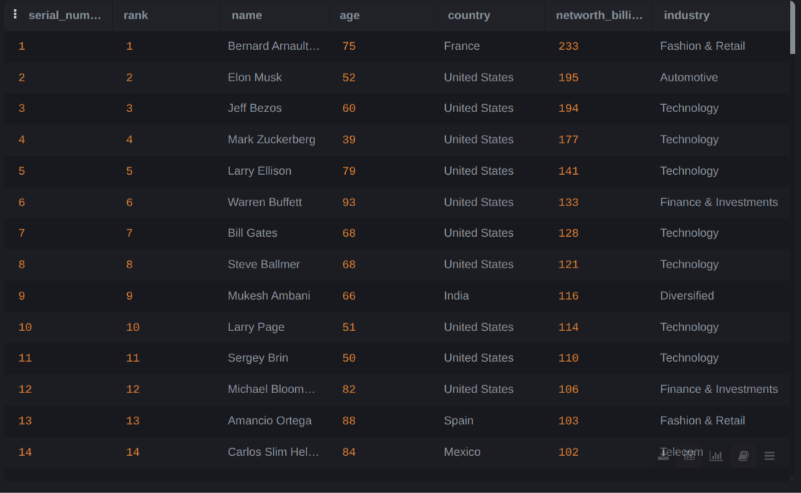

  
  
                     •

                     •

                     •

  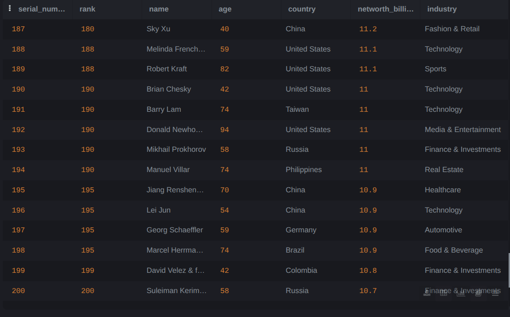


2. **First ten billionaires**
```sql
SELECT *
FROM Top200RichestPersonintheWorld
ORDER BY networth_billion DESC
LIMIT 10;
```
  
  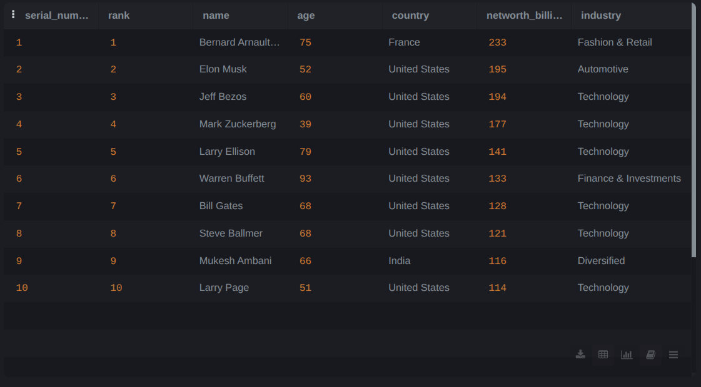


3. **Industries Present**
```sql
SELECT DISTINCT industry
FROM Top200RichestPersonintheWorld;
```
  
  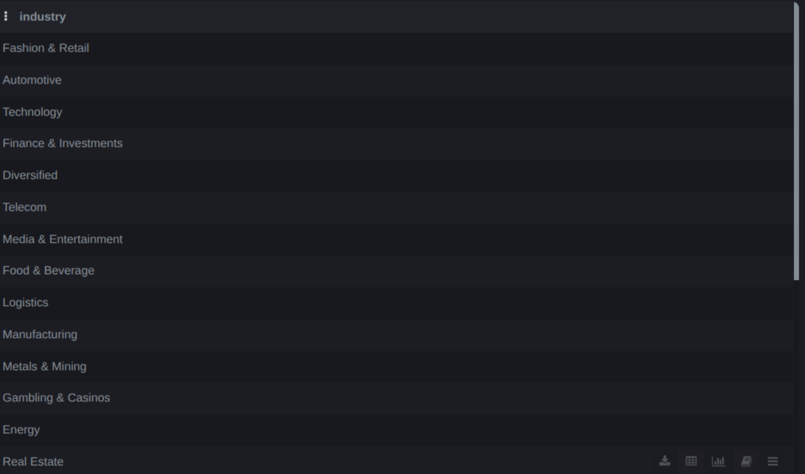


  
  
                     


4. **Count of Industries**
```sql
SELECT COUNT(DISTINCT industry)
FROM Top200RichestPersonintheWorld;
```

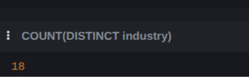


5. **Countries Present**
```sql
SELECT DISTINCT country
FROM Top200RichestPersonintheWorld;
```
  
  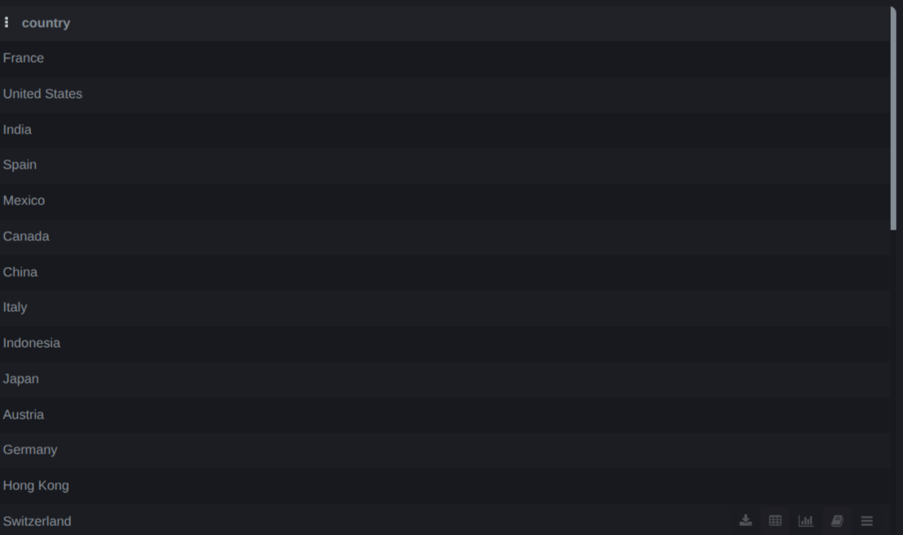


  
  
                     •

                     •

                     •
                     
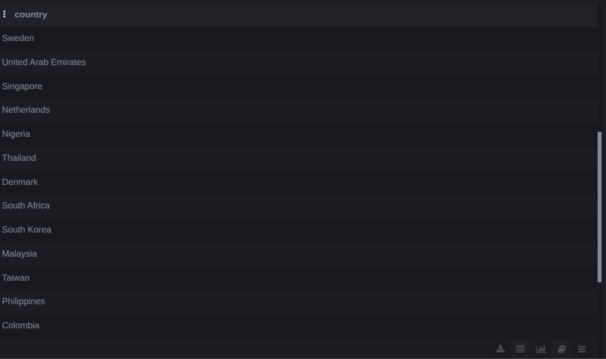


6. **Count of countries**
```sql
SELECT COUNT(DISTINCT country)
FROM Top200RichestPersonintheWorld;
```

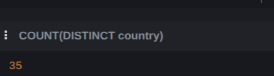


### B. Sorting Data
1. **Five Oldest Billionaires**
```sql
SELECT *
FROM Top200RichestPersonintheWorld
ORDER BY age DESC
LIMIT 5;
```

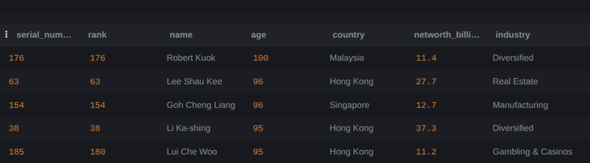


2. **Five Youngest Billionaires**
```sql
SELECT *
FROM Top200RichestPersonintheWorld
ORDER BY age ASC
LIMIT 5;
```
   
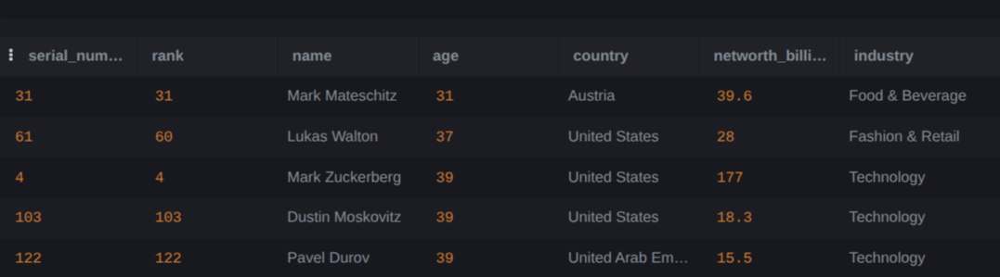

 

3. **Ten Wealthiest Billionaires**
```sql
SELECT *
FROM Top200RichestPersonintheWorld
ORDER BY networth_billion DESC
LIMIT 10;
```
   
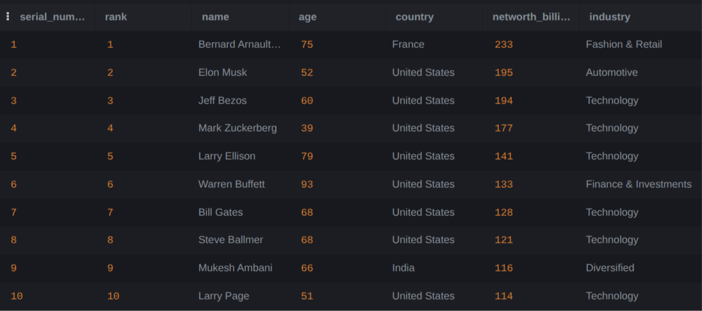

 
 4. **Richest Billionaire**
```sql
SELECT *
FROM Top200RichestPersonintheWorld
ORDER BY networth_billion DESC
LIMIT 1;
```
   
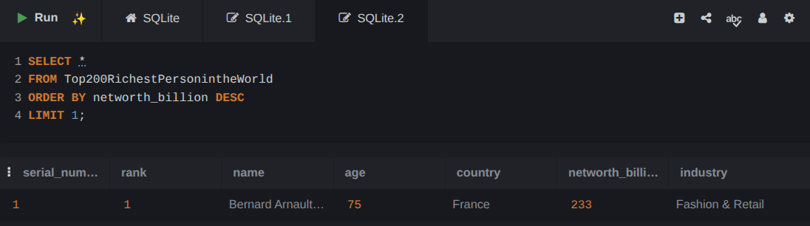


### C. Filtering Data
1. **Billionaires with Net Worth Greater than 100 Billion**
```sql
SELECT *
FROM Top200RichestPersonintheWorld
WHERE networth_billion > 100
ORDER BY networth_billion DESC;
```

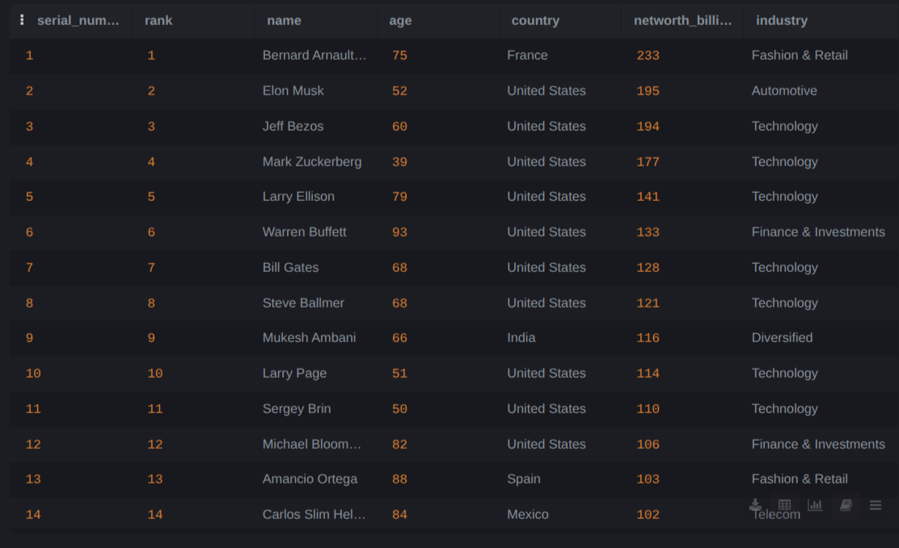


2. **Billionaires with Ages between 40 and 60**
```sql
SELECT *
FROM Top200RichestPersonintheWorld
WHERE age>=40 AND age<=60;
```

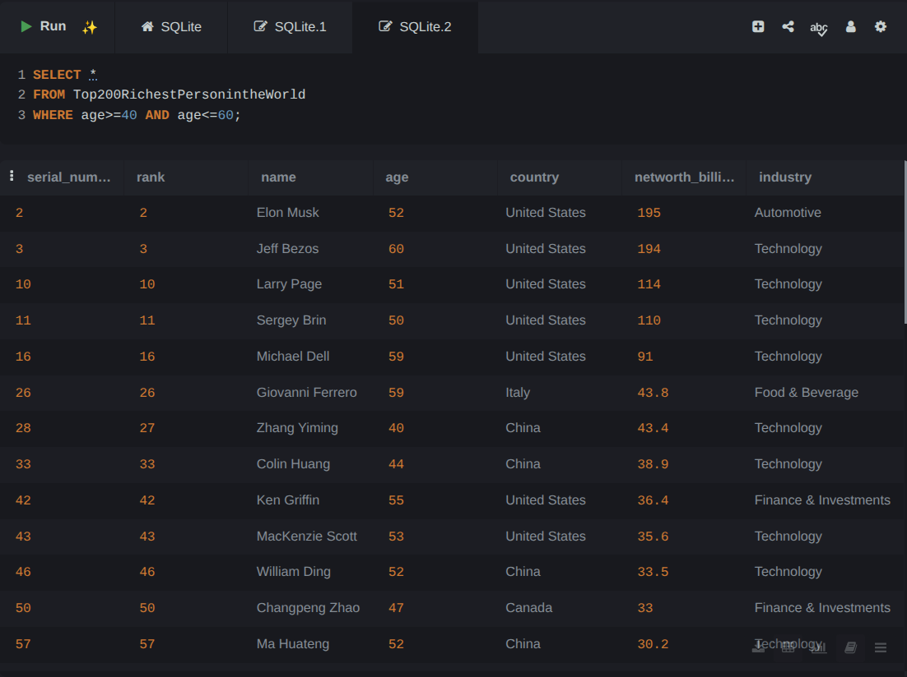


  
  
                     •

                     •

                     •


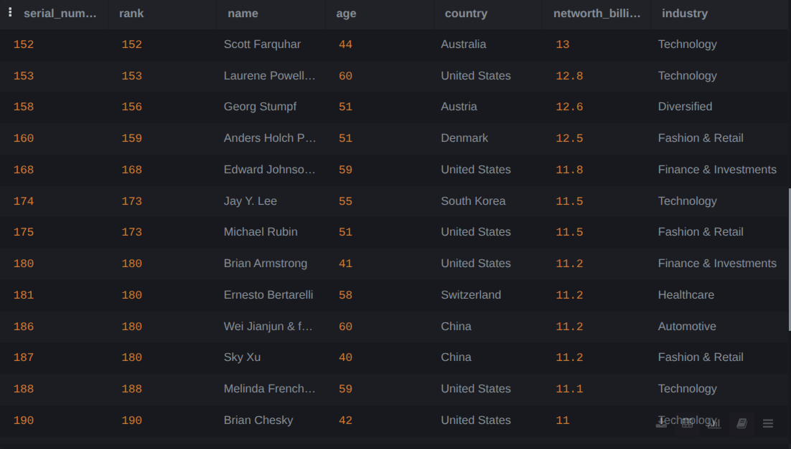


 
3. **Billionaires less than 40 years**
```sql
SELECT *
FROM Top200RichestPersonintheWorld
WHERE age < 40
ORDER BY age ASC;
```

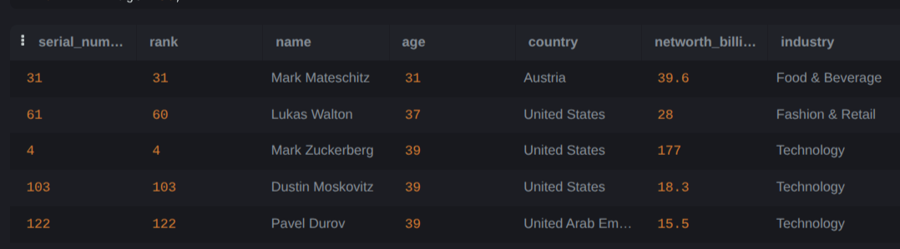


 
4. **Billionaires in Nigeria**
```sql
SELECT *
FROM Top200RichestPersonintheWorld
WHERE country = 'Nigeria';
```

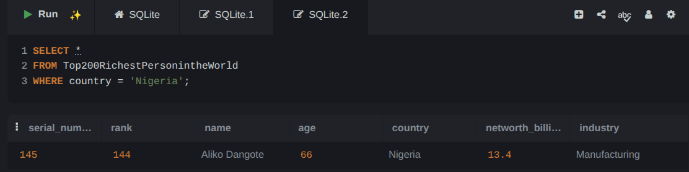


5. **Billionaires from either United States, China or India**
```sql
SELECT *
FROM Top200RichestPersonintheWorld
WHERE country = 'United States' OR country = 'China' OR country = 'India';
```

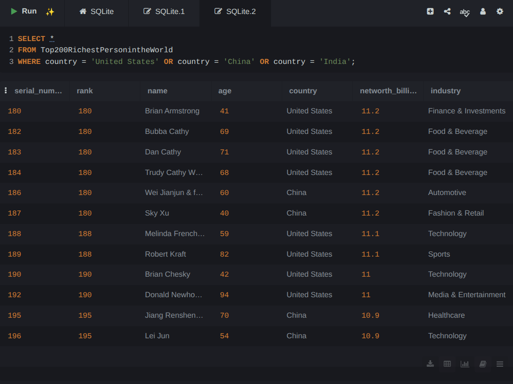


  
  
                     •

                     •

                     •


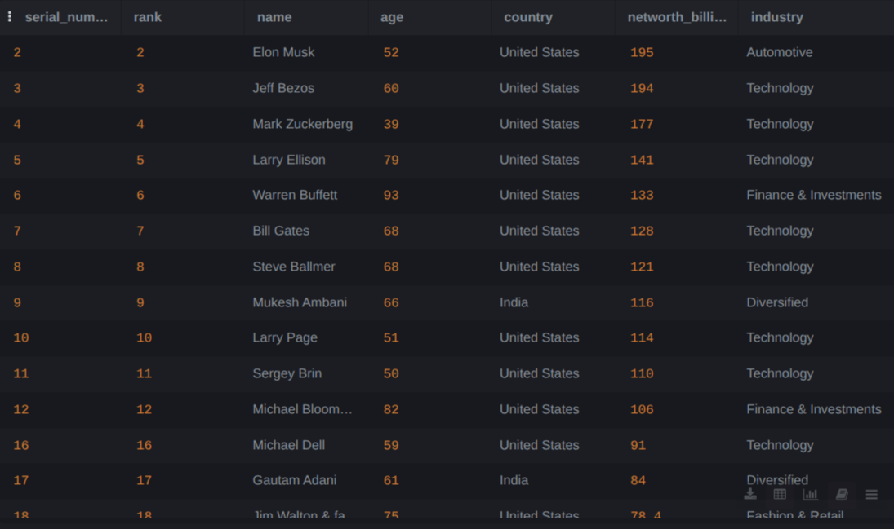


### D. Aggregate Functions
1. **Age difference between oldest and youngest billionaires**
```sql
SELECT MAX(age) AS oldest_billionaire,
MIN(age) AS youngest_billionaire,
MAX(age) - MIN(age) AS age_difference_between_oldest_and_youngest_billionaire
FROM Top200RichestPersonintheWorld;
```

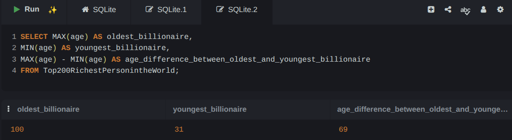


2. **Highest Net Worth**
```sql
SELECT MAX(networth_billion) AS highest_net_worth
FROM Top200RichestPersonintheWorld;
```


3. **Combined Net Worth of Billionaires**
```sql
SELECT ROUND(SUM(networth_billion), 2) AS combined_net_worth_of_billionaires
FROM Top200RichestPersonintheWorld;
```

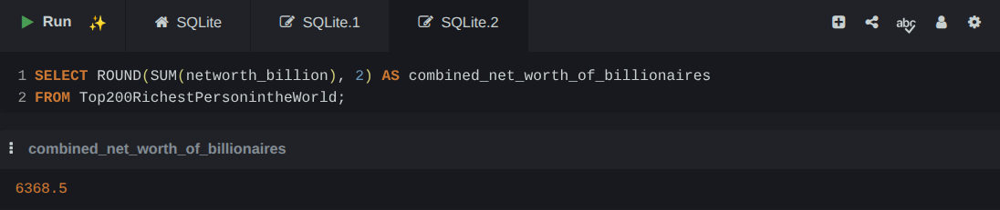


4. **Lowest Net Worth**
```sql
SELECT MIN(networth_billion) AS lowest_net_worth
FROM Top200RichestPersonintheWorld;
```

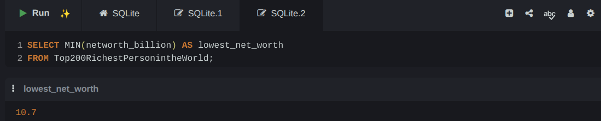


5. **Average Net Worth**
```sql
SELECT ROUND(AVG(networth_billion), 2) AS average_net_worth_of_billionaires
FROM Top200RichestPersonintheWorld;
```

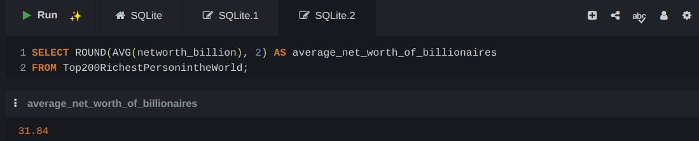


6. **Average Age**
```sql
SELECT ROUND(AVG(age), 2) AS average_age_of_billionaires
FROM Top200RichestPersonintheWorld;
```

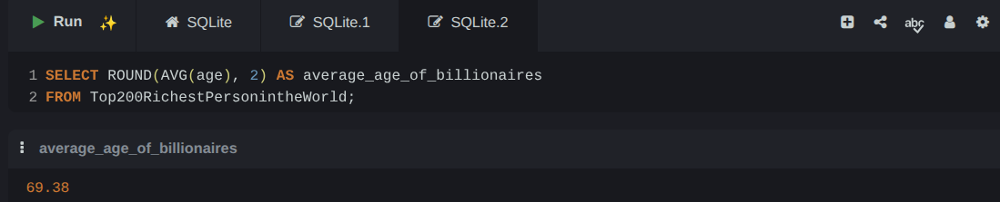


### E. Categorising Data Using GROUP BY
1. **5 Industries with the highest total net worth**
```sql
SELECT industry, ROUND(SUM(networth_billion), 2) AS total_net_worth
FROM Top200RichestPersonintheWorld
GROUP BY industry
ORDER BY total_net_worth DESC
LIMIT 5;
```

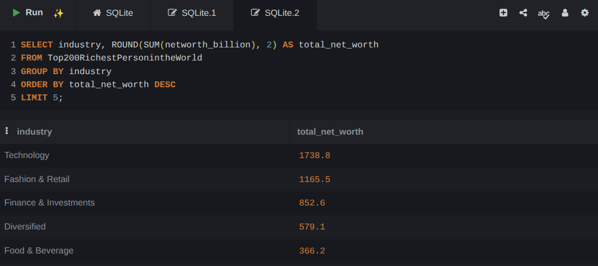


2. **Countries with at least five billionaires**
```sql
SELECT country, COUNT (*) AS billionaires_count
FROM Top200RichestPersonintheWorld
GROUP BY country
HAVING COUNT(*) >=5
ORDER BY billionaires_count DESC;
```

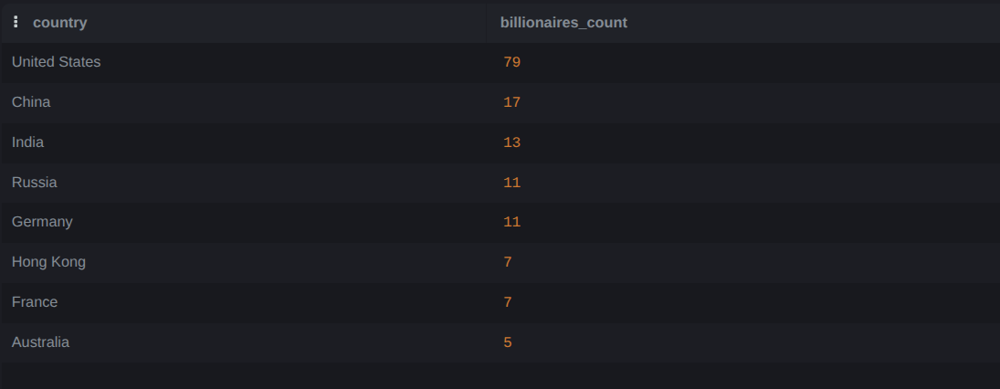


3. **Industry with the highest number of billionaires**
```sql
SELECT industry, COUNT(*) AS billionaires_count
FROM Top200RichestPersonintheWorld
GROUP BY industry
ORDER BY billionaires_count DESC
LIMIT 1;
```

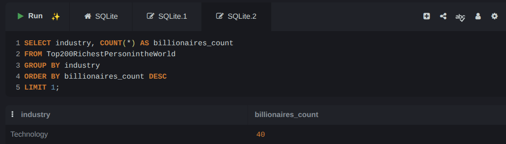


4. **Billionaires per country**
```sql
SELECT country, COUNT(*) AS billionaires_count
FROM Top200RichestPersonintheWorld
GROUP BY country
ORDER BY billionaires_count ASC;
```

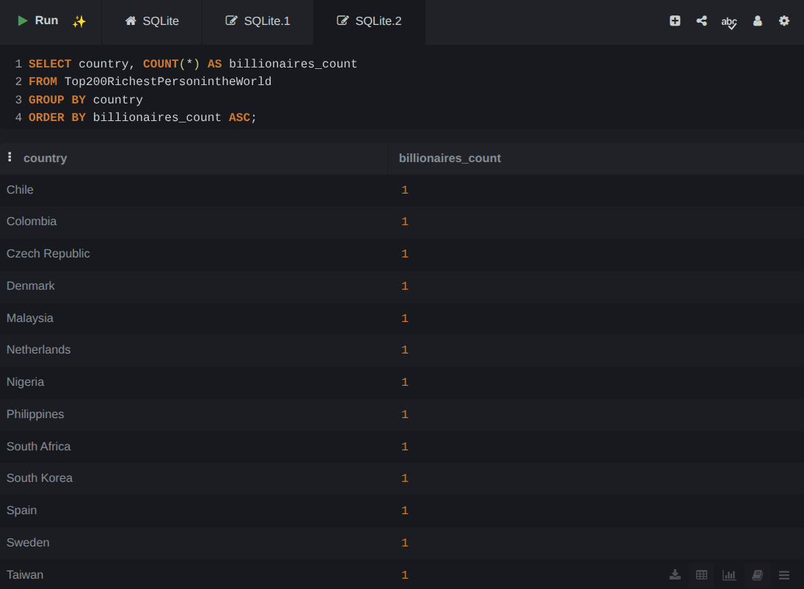


### F. Advanced Analytical Questions
1. **Net Worth Range**
```sql
SELECT MAX(networth_billion) AS richest_billionaire,
MIN(networth_billion) AS poorest_billionaire,
MAX(networth_billion) - MIN(networth_billion) AS net_worth_range
FROM Top200RichestPersonintheWorld;
```


2. **Number of Billionaires with net worth above 50 billion dollars**
```sql
SELECT COUNT (networth_billion) AS number_of_billionaires_with_over_50_billion_net_worth
FROM Top200RichestPersonintheWorld
WHERE networth_billion > 50;
```


3. **Percentage younger than 50 years**
```sql
SELECT (SELECT COUNT (age) 
FROM Top200RichestPersonintheWorld
WHERE age < 50) AS number_less_than_50_years,
COUNT (*) AS billionaires_count,
(SELECT COUNT (age) 
FROM Top200RichestPersonintheWorld
WHERE age < 50) * 100/ COUNT(*) AS percentage_younger_than_50
FROM Top200RichestPersonintheWorld;
```


4. **Industry with highest total net worth**
```sql
SELECT industry, SUM(networth_billion) AS total_industry_net_worth
FROM Top200RichestPersonintheWorld
GROUP BY industry
ORDER BY total_industry_net_worth DESC
LIMIT 1;
```


## 8. Key Findings and Insights

This section will document the major findings obtained from the analysis, highlighting patterns in billionaire wealth distribution, geographical representation, industry contributions and age demographics.

Findings will be updated as the analysis progresses.

## 9. Project Structure

The repository is organised into the following directories:

- **"dataset/"** – Contains the dataset used for the analysis, subject to redistribution permissions.
- **"sql_queries/"** – Contains the SQL scripts used to answer the analytical questions.
- **"screenshots/"** – Contains screenshots of SQL queries and their corresponding results.
- **"README.md"** – Provides an overview, objectives, methodology and findings of the project.

## 10. Conclusion

This project provides an opportunity to apply SQL to a real-world wealth dataset, moving from basic data exploration to more advanced analytical queries.

Through the analysis, I aim to strengthen my understanding of relational data querying, develop analytical problem-solving skills and demonstrate how structured data can be used to investigate patterns and generate meaningful insights.
